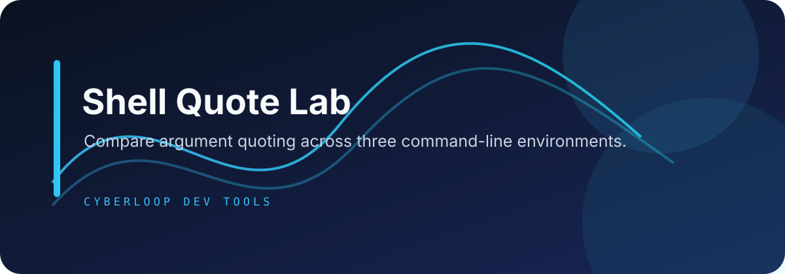

<div align="center">


<a href="https://github.com/CyberLoop-dev/shell-quote-lab">

</a>

<p><strong>Compare command-argument quoting for POSIX shells, PowerShell, and Windows command lines without executing commands.</strong></p>

[](LICENSE)
[](https://github.com/CyberLoop-dev/shell-quote-lab)
[](https://github.com/CyberLoop-dev/shell-quote-lab/stargazers)
[](https://github.com/CyberLoop-dev/shell-quote-lab/commits/main)



</div>

## ✨ Overview

Compare command-argument quoting for POSIX shells, PowerShell, and Windows command lines without executing commands. **Shell Quote Lab** is a small Python command-line tool built with the standard library. It is designed for local use and keeps its behavior explicit.

## 🚀 Features

- ✨ 🧩 Compare POSIX, PowerShell, and Windows argument quoting.
- ✨ 🧪 Handle spaces, apostrophes, quotes, and trailing backslashes.
- ✨ 🛡️ Generate text only; no shell command is executed.
- ✨ 🧾 Review all target formats side by side.

## 🖥️ Demo

```bash
python main.py --demo
```

The demo prints equivalent quoting examples for POSIX shells, PowerShell, and Windows argv rules. It never executes the generated command.

## ⚡ Quick Start

```bash
python main.py --demo
```

Python 3.10 or newer is required. No third-party packages are needed.

## 🧰 Tech Stack

- **Language:** Python 3.10+
- **Libraries:** Python standard library
- **Dependencies:** None

## 📁 Folder Structure

```text
shell-quote-lab/
├── assets/overview.svg
├── tests/test_main.py
├── main.py
├── pyproject.toml
├── .gitignore
├── LICENSE
└── README.md
```

## 🗺️ Roadmap

- [ ] Add a JSON output mode for tooling integrations.
- [ ] Add more edge-case fixtures for platform-specific quoting.

## 🤝 Contributing

Issues and pull requests are welcome. Include a minimal input example, expected behavior, and a regression test when changing parsing or quoting rules.

## 📄 License

Released under the [MIT License](LICENSE).

<div align="center">

</div>
